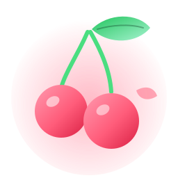
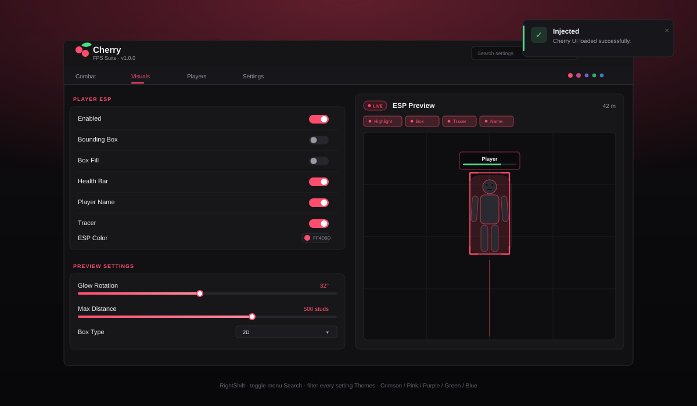
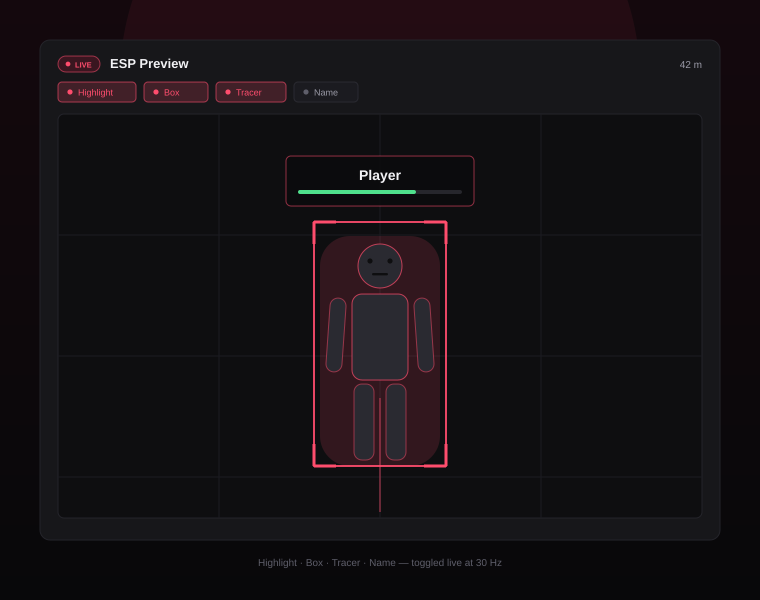

<p align="center">
  
</p>

<h1 align="center">Cherry UI</h1>

<p align="center">
  <strong>A high-performance, cherry-picked UI library for Roblox FPS games.</strong><br />
  Dark, dense, and built to stay out of your frame budget.
</p>

<p align="center">
  
  
  
</p>

---

Cherry UI is a single-module Roblox UI library focused on FPS menus: aimbot and
ESP settings, player utilities, live previews and fast iteration. It is drawn
entirely in code (no image assets required), ships five themes, and keeps a
tight lid on instance churn and update frequency.

## Features

- **Performance first** — pooled notifications and dropdown options, lazily
  built tabs, a shared 30 Hz scheduler instead of per-frame loops, and a
  `:Destroy()` on every object.
- **Reference-style layout** — dark charcoal glass, cherry-red accents, compact
  top tabs with an accent underline, and a dense settings panel.
- **Five themes** — Crimson (default), Pink, Purple, Green, Blue, switchable at
  runtime with animated recoloring.
- **Live ESP preview** — an interactive 2D avatar with highlight, box, corner
  brackets, tracer, name tag and health bar, all toggled from chips above the
  stage. Hook it into your real ESP with `preview:OnChanged`.
- **Player list** — live server roster with teleport / spectate / copy actions.
- **Config saving** — serialize the whole UI (values, theme, keybind) to memory,
  a JSON file, a DataStore or your own backend.
- **Search** — filter every setting from the header search box.
- **Dependency boxes** — hide controls behind a master toggle with
  `:AddDependency`.
- **Cherry cursor** — a themed cherry badge trails Roblox's own pointer (which stays sharp and untouched)
  drawn in code (`CherryUI:SetCursorMode("menu" | "always" | "off")`).
- **Runs in executors** — [`dist/CherryUI.lua`](dist/CherryUI.lua) is a
  single-file bundle for Lua executors and `loadstring`, built by
  `python3 tools/bundle.py`.
- **FPS essentials** — keybinds, numeric text boxes, color pickers, sliders and
  dropdowns (single and multi select).

## Screenshots

<p align="center">
  
</p>

<p align="center">
  
</p>

> These are vector mockups that ship with the repository. Replace them with
> real captures (`docs/screenshot_main.png`, `docs/screenshot_esp.png`) once
> you have your own branding.

## Quick start

```lua
local ReplicatedStorage = game:GetService("ReplicatedStorage")
local CherryUI = require(ReplicatedStorage:WaitForChild("CherryUI"))

local Window = CherryUI:CreateWindow({
    Title = "Cherry",
    Subtitle = "FPS Suite",
})

local Tab = Window:AddTab("Combat", "target")
local Section = Tab:AddSection("Aimbot")

Section:AddToggle({
    Name = "Enable Aimbot",
    Default = true,
    Callback = function(enabled)
        print("Aimbot:", enabled)
    end,
})
```

Press **RightShift** to toggle the menu. To rebind it:

```lua
CherryUI:SetToggleKey(Enum.KeyCode.Insert)
```

### Executors and single-file scripts

Lua executors cannot `require` a ModuleScript tree, so the library also builds to
one chunk: [`dist/CherryUI.lua`](dist/CherryUI.lua) (rebuild with
`python3 tools/bundle.py`). Paste it into the executor, then build your menu
below it, or load it from a URL:

```lua
local CherryUI = getgenv().CherryUI
    or loadstring(game:HttpGet("https://raw.githubusercontent.com/USER/Cherry-UI/main/dist/CherryUI.lua"))()

local Window = CherryUI:CreateWindow({ Title = "Cherry" })
Window:AddTab("Combat", "target", function(tab)
    tab:AddSection("Aimbot"):AddToggle({ Name = "Enable Aimbot" })
end)
```

The bundle publishes itself on `getgenv().CherryUI`, so other scripts can reuse
the same window instead of building a second one. The cherry cursor is applied
as soon as the library loads; `CherryUI:SetCursorMode("menu")` restricts it to
the open menu, and `"off"` restores Roblox's pointer.

## Documentation

The full integration guide lives in **[setup.md](setup.md)**. It covers Rojo and
manual installation, every component, themes, notifications, config backends,
the ESP preview hook, player list actions and troubleshooting.

The complete function reference — every method, config key and icon name — is
**[API.md](API.md)**.

Working on Cherry UI itself? **[RESUME.md](RESUME.md)** covers the development
loop: the Rojo plugin end to end, both project files, static checks that run
without Studio, and how to publish the repo and release the model.

## Project layout

```
src/
├── init.lua                 -- library entry point (Library.new)
├── Example.lua              -- complete FPS menu demo
├── Components/
│   ├── Window.lua           -- draggable/resizable window, tabs, search
│   ├── Tab.lua              -- lazy tab pages
│   ├── Section.lua          -- grouped setting cards
│   ├── Button.lua           -- primary / secondary / danger
│   ├── Toggle.lua           -- animated switch
│   ├── Slider.lua           -- drag + precise numeric input
│   ├── Dropdown.lua         -- single / multi select, pooled options
│   ├── TextBox.lua          -- text + numeric input
│   ├── Keybind.lua          -- click-to-rebind key capture
│   ├── ColorPicker.lua      -- HSV square, hue strip, hex input
│   ├── Notification.lua     -- pooled top-right toasts
│   ├── ESPPreview.lua       -- live interactive ESP preview
│   └── PlayerList.lua       -- server roster + quick actions
├── Core/
│   ├── ThemeManager.lua     -- runtime palette switching
│   ├── Cursor.lua           -- code-drawn cherry pointer
│   └── Logo.lua             -- procedural cherry logo + petals
├── Themes/
│   ├── Crimson.lua
│   ├── Pink.lua
│   ├── Purple.lua
│   ├── Green.lua
│   └── Blue.lua
└── Utils/
    ├── Base.lua             -- shared component behavior
    ├── Config.lua           -- save/load manager
    ├── Create.lua           -- instance helpers
    ├── Icons.lua            -- font-independent drawn icons
    ├── Pool.lua             -- instance pool
    ├── Popup.lua            -- dropdown/color-picker popups
    ├── Fade.lua             -- subtree transparency fades
    ├── Scheduler.lua        -- capped 30 Hz update loop
    ├── Signal.lua           -- lightweight signals
    ├── Tween.lua            -- easing presets
    └── Util.lua             -- numbers, keys, colors, clipboard
dist/
└── CherryUI.lua             -- generated single-file bundle (executors)
tools/
└── bundle.py                -- builds dist/CherryUI.lua from src/
```

## Design notes

- **Glass without blur.** Roblox has no backdrop blur, so the window layers a
  translucent panel, a top sheen and two low-opacity accent glows instead.
- **Motion budget.** Micro-interactions use `Quad` (0.08–0.14s), tab and window
  transitions use `Quart` (0.24–0.36s), and only the window intro uses `Back`.
- **Sizing.** Internal layout is UDim2 scale-based with list layouts; the whole
  window sits under a `UIScale` that adapts between 0.7× and 1.1× based on
  viewport size, and `ScreenInsets` respects the topbar and safe areas.

## License

MIT — see [LICENSE](LICENSE).

Cherry UI is not affiliated with or endorsed by Roblox Corporation.
